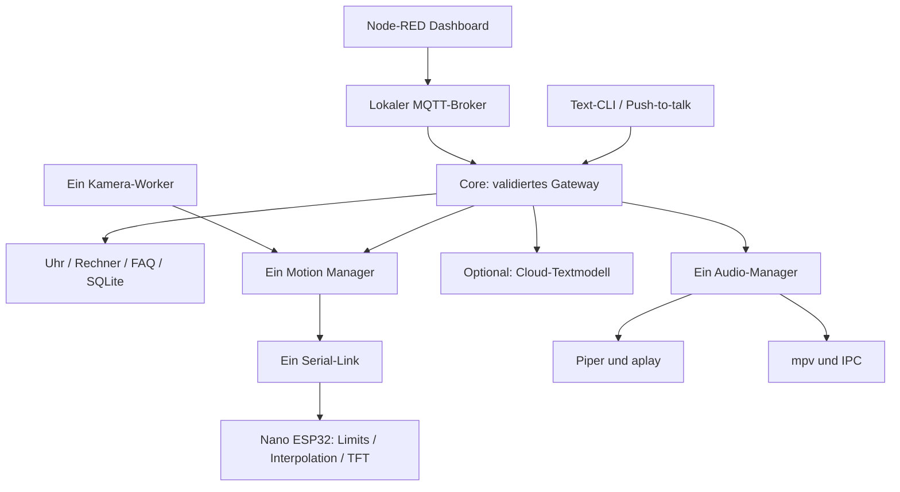

> Aktueller Stand: Sechs Cloudanbieter und Spotify sind über die Dashboard-Seite „Verbindungen“ einrichtbar. [Vertrag und Einrichtung](VERBINDUNGEN.md). Keine lokalen LLMs; STT/TTS bleiben lokal. Echte Anbieter-/Pi-Abnahme bleibt offen.

# Architektur und Schnittstellen

## 1. Datenfluss



Ein Prozess enthält genau eine Instanz je Ressource. Node-RED nutzt den lokalen MQTT-Broker für Befehle, Status und Antworten und öffnet nicht zusätzlich den Nano-Port. JPEG-Vorschau und Diagnose-API bleiben HTTP-basiert. Details: [MQTT und Kamera](MQTT_UND_KAMERA.md).

Der Core läuft auf einem asyncio-Eventloop. Blockierende STT-, Kamera-, Netzwerk- und Serial-Leseoperationen laufen in Workern. Audioausgabe nutzt asynchrone Kindprozesse. HTTP-Handler übergeben Befehle threadsicher an denselben Eventloop. SQLitezugriffe des Core sind kurz und synchron.

## 2. Aufträge und Resultate

```json
{
  "schema": "rovo.command.v1",
  "request_id": "optionale-eigene-id",
  "type": "text",
  "args": {"text":"Was ist 25 mal 17?"}
}
```

`schema` darf fehlen, wird dann als Version 1 behandelt. Unbekannte Schlüssel, Aktionen und Argumente werden abgewiesen. Eigene Auftrags-IDs dürfen 1 bis 80 Zeichen haben. **Es gibt noch keinen persistenten Idempotenzspeicher:** dieselbe ID darf nicht für automatisches Wiederholen einer Aktion verwendet werden.

Resultat:

```json
{
  "schema": "rovo.result.v1",
  "request_id": "optionale-eigene-id",
  "ok": true,
  "status": "completed",
  "intent": "math.evaluate",
  "spoken_reply": "Das Ergebnis ist 425.",
  "error_code": null,
  "data": {"value":425},
  "simulated": true
}
```

| Status | Bedeutung |
| --- | --- |
| `completed` | Lokale Aktion abgeschlossen |
| `acknowledged` | Bewegungs-/Displayziel angenommen; keine gemessene Position |
| `confirmation_required` | Notizlöschung vorbereitet, noch nicht ausgeführt |
| `partial` | Lokaler Stopp verarbeitet, Hardwarebestätigung fehlt |
| `cancelled` | Spätes Modellergebnis nach Stopp/Privatsphäre verworfen |
| `error` | Validierung, Verbindung oder Komponente verhindert Ausführung |

`ok=true` bei `partial` bestätigt nur den in `data` beschriebenen Teilerfolg. Der Hardwarestatus muss separat gelesen werden. Auch `simulated=true` bedeutet niemals einen echten Hardwaretest.

## 3. HTTP-API starten

Ein zufälliges Token mit mindestens 32 Zeichen erzeugen und außerhalb des Repositories als `ROVO_API_TOKEN` setzen. Zum Beispiel nach vorhandenem Python:

```bash
export ROVO_API_TOKEN="$(python3 -c 'import secrets; print(secrets.token_urlsafe(32))')"
.venv/bin/python -m rovo serve --config config/default.json
```

Für späteren Dauerbetrieb das Token in einer nur vom Dienstbenutzer lesbaren Umgebungsdatei speichern. Es nicht in die Shell-History, Flow-JSONs oder Screenshots kopieren. Der obige Generierungsbefehl enthält keinen konkreten Schlüssel.

| Methode | Pfad | Ergebnis |
| --- | --- | --- |
| GET | `/api/v1/status` | Statussnapshot mit Zeit und Fähigkeiten |
| GET | `/api/v1/events` | Letzte bis zu 100 Timer-/Audioereignisse, keine konsumierende Queue |
| GET | `/api/v1/camera.jpg` | Aktuelles JPEG, sonst 404 |
| POST | `/api/v1/command` | Schema-geprüfter Befehl |
| POST | `/rpc` | V5-Kompatibilität: `{"action":"chat.send","data":{"text":"Hallo"}}` |

Jede Route erfordert `Authorization: Bearer TOKEN`. POST zusätzlich `Content-Type: application/json`. Maximal 16 KiB Body. `Origin`-Header werden abgewiesen; der Browser spricht über Node-RED, nicht direkt mit der Bridge. Keine CORS-Freigabe.

`X-ROVO-Session` bindet kurze Rückfragen an eine Sitzung. Node-RED übernimmt dafür die serverseitig übermittelte Dashboard-Socket-ID. Ein direkter API-Client muss seine Sitzungs-ID selbst stabil halten. Diese ID ist keine eigene Benutzeranmeldung; API-Token und geschütztes Dashboard bilden die Zugangsgrenze.

Der Dienst ist eine lokale Integrationsbridge für das eigene LAN-Projekt, kein gehärteter öffentlicher Webserver. Externe Erreichbarkeit nur über einen separat abgesicherten TLS-Proxy. Keine automatische Internetfreigabe.

## 4. Registrierte Aktionen

| Typ | Exakte Argumente |
| --- | --- |
| `text` | `text`: Zeichenkette, 1–2000 Zeichen |
| `status`, `stop` | `{}` |
| `motion.home` | `{}` |
| `motion.set` | `pan`, `tilt`: endliche Winkel innerhalb Kalibrierung |
| `motion.relative` | `axis`: `pan`/`tilt`, `delta`: endliche Gradzahl |
| `display.face` | `face`: freigegebener Firmwaremodus |
| `camera.enable`, `camera.disable` | `{}` |
| `tracking.enable`, `tracking.disable` | `{}` |
| `privacy.enable`, `privacy.disable` | `{}` |
| `notes.add` | `text`: 1–2000 Zeichen |
| `notes.list` | `{}` |
| `notes.delete` | `id`, `confirmation_token`: aus frischer Löschanfrage |
| `timer.start` | `seconds`: 0,1 Sekunden bis 365 Tage |
| `timer.status` | `{}` |
| `timer.action` | `id`, `action`: `pause`/`resume`/`cancel` |
| `music.play` | `path`: freigegebene lokale Audiodatei |
| `music.pause`, `music.resume`, `music.stop` | `{}` |
| `music.volume` | `value`: ganzzahlig, 0–100 |
| `audio.stop`, `audio.test` | `{}`; Stop bzw. fester lokaler Piper-Sprachtest |

Der V5-Adapter in `rovo/dashboard.py` übersetzt UI-Aktionen in dieselben Core-Befehle. Er liest nur eine öffentliche Konfigurationsprojektion und verweigert unvollständige Verwaltungsaktionen. Alte UI-Testwinkel sind keine Kalibrierung. V5-Importhinweise sind in `nodered/README.md` dokumentiert.

Zum Erzeugen einer Löschanfrage `text` mit „Lösche meine letzte Notiz“ senden. Mit „Ja“ aus derselben Sitzung bestätigen oder den zurückgegebenen Token an `notes.delete` senden. Nach 20 Sekunden oder einem anderen Befehl verfällt die Freigabe.

Es gibt keine Shell-, Python-, Firmware-, Shutdown- oder frei definierbare LLM-Toolaktion. Weitere Funktionen müssen bewusst mit Schema und Handler ergänzt werden.

## 5. Mathematik

`math_de.py` ersetzt deutsche Zahlwörter und Operatorwörter, tokenisiert den gesamten Ausdruck und wertet ihn mit einem eigenen Präzedenzparser aus. Unverbrauchte Zeichen werden abgewiesen. Kein `eval`, `exec`, Attributzugriff oder Python-AST.

Unterstützt: Grundrechenarten, Klammern, negatives Vorzeichen, Dezimalkomma, deutsche zusammengesetzte Zahlwörter, Potenz, Quadratwurzel und `Prozent von`. Potenzen sind rechtsassoziativ. Potenz bindet stärker als ein führendes Minus: `-2^2 = -4`.

Grenzen: 256 Zeichen, 100 Tokens, Verschachtelung 20, Exponentbetrag 12, Ergebnisbetrag 10^15. Nullteilung und negative reelle Wurzeln liefern Fehler. Große Wortaufgaben, freie Einheitenumrechnung und komplexe Prozentgrammatik sind noch nicht enthalten.

## 6. Bewegungsvertrag

Alle Ziele laufen durch `Motion`. Nicht endliche Werte, Boolesche Werte, nicht kalibrierte Grenzen, veraltete Trackingbeobachtungen und fehlende Hardwarefreigabe werden zurückgewiesen. Tracking akzeptiert maximal 250 ms alte Beobachtungen. Manuelle Bewegung pausiert Tracking drei Sekunden. Stopp deaktiviert Tracking und verwirft den bekannten End-Sollwert, da der intern erreichte Winkel ohne Sensor unbekannt ist.

Ein Stopp erhöht die Abbruchgeneration: Vorher wartende Bewegungsaufträge dürfen danach nicht nachfahren. Serial-Loss führt zu keinem automatischen Reconnect und keiner Wiederholung alter Bewegungsziele. Neuverbindung verlangt einen neuen Prozessstart und bewusste Positionierung.

## 7. Serial-Protokoll Version 1

115200 Baud, ASCII, eine Zeile pro Nachricht, maximal 127 Zeichen Firmware-Eingangsbuffer. Die Pi-Seite sendet höchstens 120 Zeichen. Historische `PAN:`, `TILT:`, `MOVE:` oder `P:`-/`T:`-Firmwares sind inkompatibel und werden nicht automatisch angesprochen.

```text
HELLO 1
HELLO 1 ROVO_ESP
CMD 1 PING
ACK 1
CMD 2 FACE HAPPY
ACK 2
CMD 3 MOVE 90.0 90.0
ACK 3
DONE 3
CMD 4 STOP
ACK 4
```

Die Winkel in diesem Protokollbeispiel sind Formatbeispiele. Ohne individuell passende Kalibrierung nimmt die Firmware keine Bewegung an. `ERR id UNCALIBRATED`, `OUT_OF_RANGE`, `HOME_REQUIRED`, `RATE_LIMIT`, `NUMBER`, `UNSUPPORTED`, `PWM`, `CANCELLED`, `REPLACED` und Syntaxfehler sind mögliche Antworten.

`ACK` bedeutet angenommen. `DONE` bedeutet ausschließlich Ende der internen Sollinterpolation. Der aktuelle Python-Link verarbeitet ACK/ERR; er veröffentlicht noch keine asynchronen DONE-Ereignisse. Es gibt keine Encoder-Istposition.

Der Core sendet etwa alle 200 ms einen PING. Bei rund 800 ms ohne gültige Nachricht stoppt die Firmware die Interpolation und hält den zuletzt intern angefahrenen Sollwert. Das ist kein physischer Not-Aus und schaltet die Servostromversorgung nicht ab.

## 8. Erweiterungspunkte

Weitere Erweiterungen: Picamera2 für CSI, trainiertes Wake-Word-Modell, zusätzliche Cloudanbieter, Wetter und Smart Home. UPS HAT (E), Face-ID und Enrollment sind optional implementiert; echte Modell-/Geräteabnahme bleibt offen. Für Erweiterungen Konfigurationsschema, Capability-Status, Offline-Verhalten, Datenschutz und Mocktests beachten. Unbekannte Sensorwerte bleiben `null`. Der aktuelle Prüfstand steht in `ROVO_PROGRESS.md`.

Der OpenAI-Adapter verwendet `POST /v1/responses`, `store=false` und ein striktes JSON-Schema für Antwort/Emotion; keine Modell-Tools. Spotify verwendet PKCE, persistente Refresh-Tokens und eine feste Zielgeräte-ID. Verwaltungsaktionen laufen über den Dashboard-Adapter (`/rpc` oder MQTT), nicht über freie Core-Konfigurationsschreibzugriffe. Aktionen und Eingabefelder stehen in [VERBINDUNGEN.md](VERBINDUNGEN.md) und `Connections.ACTIONS`; Keys/Tokens werden nicht zurückgeliefert.
